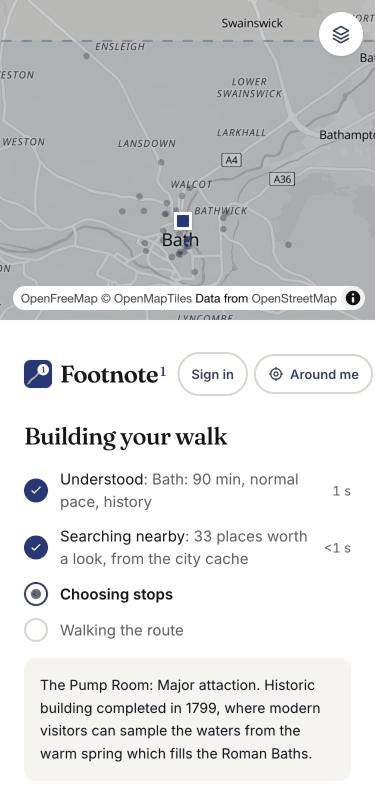
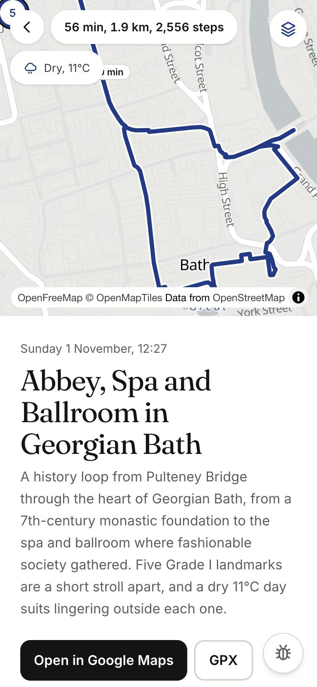
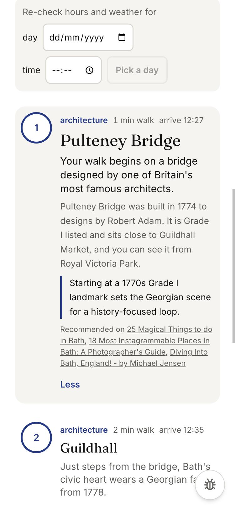
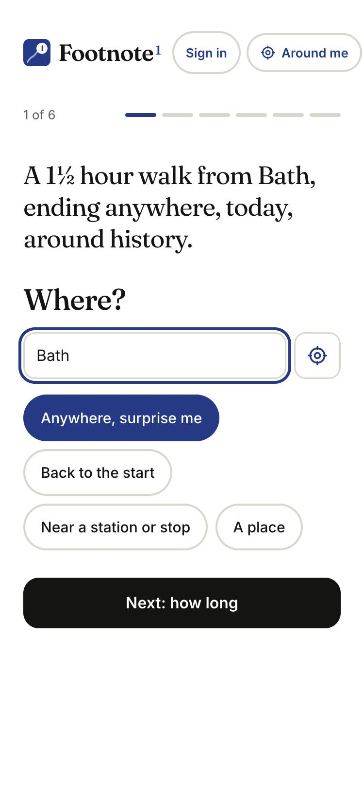
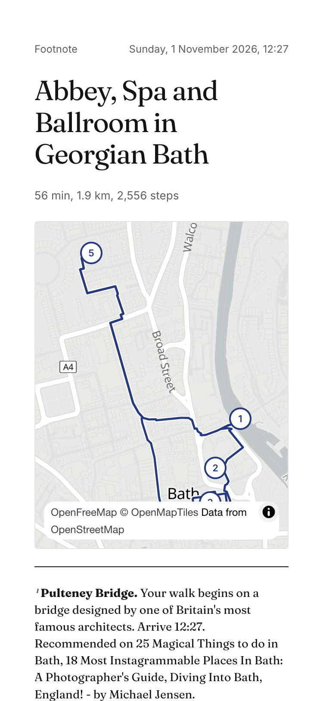

# Footnote

**A walk designed around you.**

Tell Footnote where you are, how long you have, who is with you and what you love. It builds a walk through real places, each with a short story and a reason it is there for you, routed with honest timings, on a page you can share, open in Google Maps or print.

<p align="center">
  
  
  
</p>

## Why it exists

This started as a weekend project after one too many bad holiday plans from a chatbot. Ask an AI for "a nice afternoon in a city" and you get a list of the most famous places, in no walkable order, with no map, no sense of how long any of it takes, no idea whether the museum is shut on Mondays, and now and then a place that does not exist. It reads well and plans badly.

Footnote turns that round. The model never recommends from memory. Real places come first, from open map data and from pages that recommend them, each with facts attached. The model's job is to choose a handful of them that fit the person and write a short story from the facts it was given. Everything that needs to be true, where a place is, how long it takes to get there, whether it is open, comes from maps, a router and the clock, not from the model.

## How it works

<p align="center">
  
  
</p>

1. **Answer six questions.** Where to start (a place, an address, or your location), how long you have, who is walking, what you love, when, and anything else in your own words. On a phone they come one per screen; on a desktop they sit on one page with a sentence that rewrites itself as you choose.
2. **Watch it think.** While the walk is built, the map shows the search spreading out from your start, the places being considered, and the chosen stops landing one by one. Four honest stages with real timings, never a fake progress bar.
3. **Read the walk.** A title, a two-sentence summary, the route with time pills on each leg, and one card per stop: a hook line, a short story, why it is here for you, and who recommended it. Opening hours and the weather are checked for the day you chose; a closed place is said to be closed.
4. **Take it with you.** Open the whole route in Google Maps, download a GPX file for your watch, copy the link, or print the footnoted page: the route on one sheet with a numbered note per stop.

## What makes it different

- **Nothing invented.** Every stop is a real place from open map data or a recommendation found on the web, matched to a real location. Stories are written only from facts attached to each place, every recommendation credits its source, and a place with no facts cannot become a stop.
- **Built around you, not a list.** Who is walking changes the pace and the breaks. What you love changes the stops. The free-text line is read as a constraint ("avoid hills", "end near a pub"), never ignored.
- **Honest about time.** Walking time comes from a real router at the pace of your group. Time at a stop depends on what it is: a museum is a visit, a façade is a glance. Walking never takes more than six tenths of the time you gave, no stretch between stops runs over half an hour, and a walk that would run over is shortened, never squeezed.
- **Honest about gaps.** If a city has little for an interest, the walk says so in its summary instead of stretching a museum of records into "technology".
- **Around me.** On a phone, one tap finds five places worth a story within ten minutes of where you stand, open now.

## Under the hood

- **Pipeline.** Interpret the request (the model only reads the free-text line), search real places inside a box sized to the walk, curate (the model picks from a numbered list and must cite a fact per stop; unknown numbers are rejected), fit to the time budget and route on foot. The stages stream to the browser as they finish.
- **Places.** OpenStreetMap through Overpass, with a per-city cache so a walk never waits on the public server; a scout layer that searches the web for recommended spots, pins each to a real place and keeps only the name, a one-line reason and the source link.
- **Services.** Nominatim and Photon for places and addresses, OSRM for foot routing, Open-Meteo for weather, OpenFreeMap tiles on MapLibre. The model is any OpenAI-compatible endpoint, behind LiteLLM in production so the app never holds a provider key.
- **Stack.** Next.js 16, TypeScript, Postgres with Drizzle, Tailwind, vitest and Playwright. Everything runs in containers.
- **Also in the box.** Sign-in by email code, a free trial and passes through Stripe, an owner's dashboard, maintenance mode, crawler rules, a production compose file with Caddy and a timer that pulls CI-built images, CI with a privacy scan, an independent reviewer and a QA agent.

## Run it yourself

You need Docker and an OpenAI-compatible model endpoint.

```bash
cp .env.example .env
```

Set `LLM_BASE_URL`, `LLM_API_KEY` and the two model names in `.env`, then:

```bash
docker compose up -d --build
```

The app is on http://localhost:3002 and every email it sends lands in Mailpit on http://localhost:8025. Tests, lint and the type check run inside the container:

```bash
docker compose exec -T app pnpm test
```

`CLAUDE.md` holds the working notes: the product brief, the architecture and a dated log of decisions.

## Credits

Map data © OpenStreetMap contributors. Stories draw on Wikipedia and the linked sources, credited on each stop. Tiles by OpenFreeMap; routing by OSRM; weather by Open-Meteo; geocoding by Nominatim and Photon.

MIT licence.
